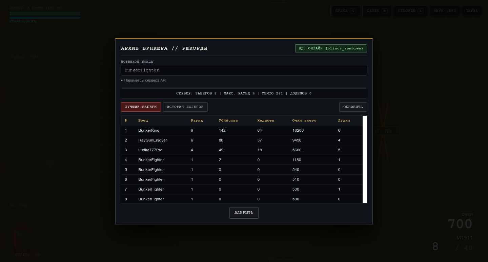
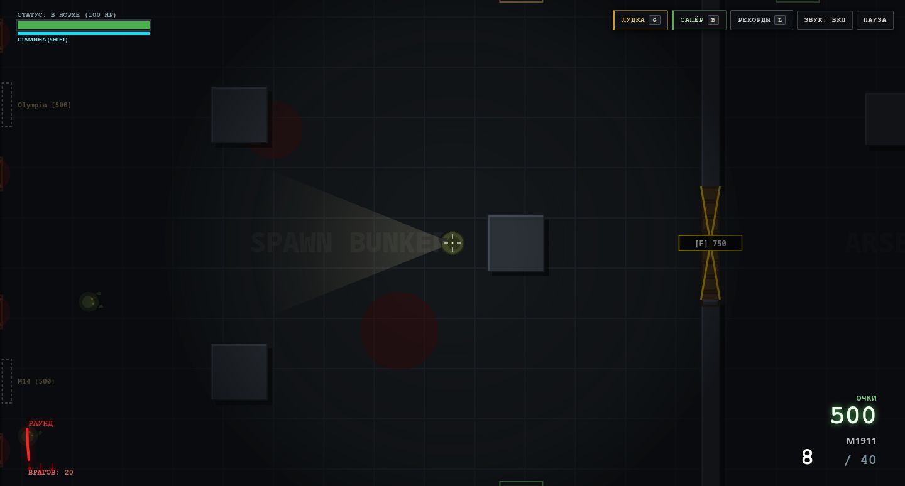
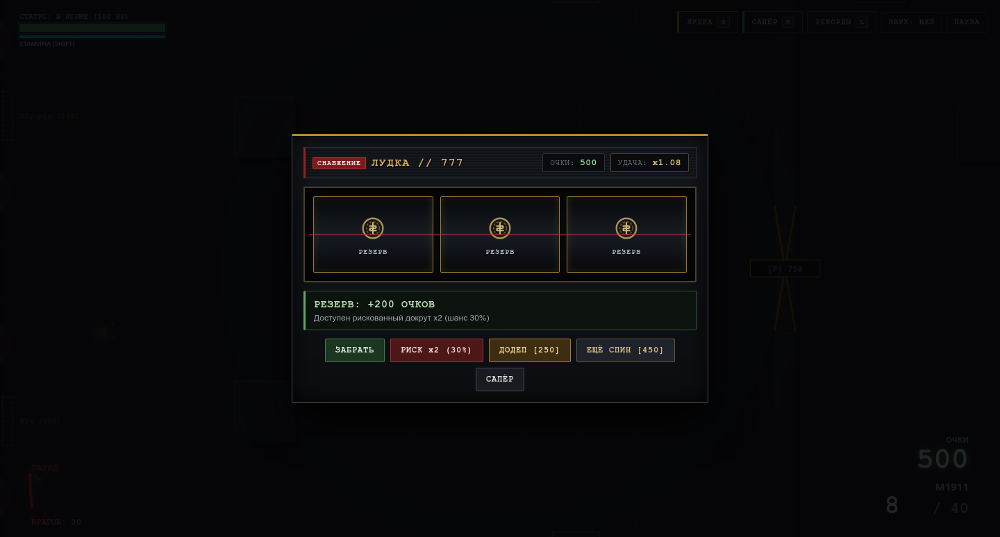
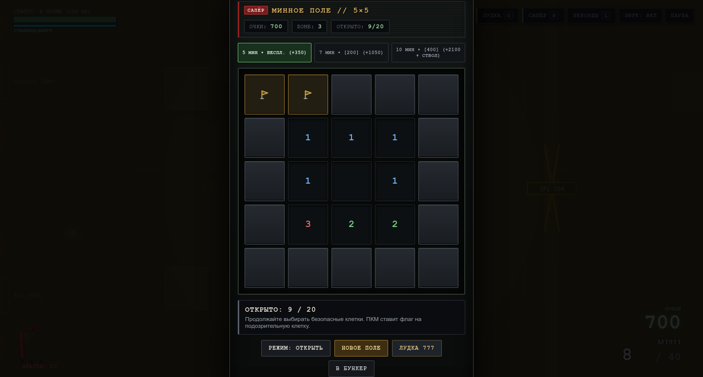

# Отчёт по проекту Call of Duty: Zombies 2D

Проект представляет собой браузерный 2D-шутер на выживание по мотивам *Call of Duty: Zombies* (бункер Nacht der Untoten), с настенным оружием, Mystery Box, системой волн, терминалами **Лудки 777**, новой мини-игрой **«Сапёр» (5×5)** и полноценным сохранением статистики в PostgreSQL.

Игра развёрнута на локальном сервере и выведена наружу через HTTPS-туннель Cloudflare (`https://above-thick-hans-conducted.trycloudflare.com`), так что зайти и поиграть может любой по ссылке без установки.

---

## 1. База данных

Для хранения статистики используется **PostgreSQL 18.6** (база `blinov_zombies`, подключение на Node.js через библиотеку `pg`). Схема описана в [db/schema.sql](./db/schema.sql) и автоматически инициализируется сервером при старте.

В базе три основные таблицы:

- **`player_profiles`** — сводный профиль по каждому никнейму: лучший раунд (`best_round`), лучший счёт (`best_score`), суммарные убийства (`total_kills`), хэдшоты (`total_headshots`), всего заработанных очков (`total_coins_earned`) и число круток/игр снабжения (`ludka_spins`).
- **`game_runs`** — история отдельных забегов: кто играл, до какого раунда дожил, сколько настрелял, сколько длился забег (`survived_sec`), использовал ли додеп-воскрешение. На этой таблице висят индексы по лучшему результату и никнейму, чтобы сортировка таблицы лидеров работала быстро.
- **`ludka_history`** — лог всех результатов из Лудки и побед в Сапёре (`outcome_id`, `outcome_title`, изменение очков `coins_delta`, выпавшее оружие `weapon_won`, а также результат риск-игры x2 — `risked` / `risk_won`).

На бэкенде ([server.js](./server.js)) подняты REST-эндпоинты:
- `GET /api/health` — проверка связи с PostgreSQL;
- `GET /api/leaderboard` — топ забегов, профили, история лудки/сапёра и общая сводка по серверу;
- `POST /api/runs` — запись завершённого забега и обновление профиля игрока в транзакции;
- `POST /api/ludka` — сохранение каждой награды из Лудки 777 и Сапёра.

На стороне клиента за синхронизацию отвечает [DatabaseModule.js](./src/modules/db/DatabaseModule.js). Если сервер вдруг недоступен (например, игру открыли локально через `file://`), модуль не падает, а сохраняет результаты локально в `localStorage`. На момент составления отчёта в живой базе уже зафиксировано **8 забегов**, **4 профиля бойцов** (максимальный раунд — 9) и **6 записей в истории снабжения**.

---

## 2. Фотки, медиа и скриншоты интерфейса

### Что было в `assets/memes/` и что с ними стало
В папке [assets/memes/](./assets/memes/) лежит 5 JPG-файлов (`photo_2026-11-13_12-11-49.jpg`, `12-12-17.jpg`, `12-14-35.jpg`, `12-14-44.jpg`, `12-14-55.jpg` — два последних файла побитово совпадают по SHA-256, то есть уникальных фотографий 4):
- фото с цифрового форума «На Ты с IT» у стенда регистрации;
- мем-коллаж на фоне пресс-волла ЮУрГУ;
- мем с пистолетом и подписью «Почему не на парах»;
- кадр с камерой Sony α7s.

Изначально эти фото подгружались сервером (через маршрут `/api/memes` с дедупликацией по SHA-256) и открывались во всплывающем окне перед Лудкой и каждые 3 раунда. На практике такие всплывающие окна только сбивали темп игры и тормозили открытие терминалов, поэтому на текущем этапе **показ мемов в интерфейсе полностью вырезан** — сами файлы остались лежать в архиве `assets/memes/`, а все кнопки и терминалы сразу пускают игрока к Лудке 777 или Сапёру без задержек.

### Как выглядит сама игра сейчас

**Основной геймплей в бункере** — вид сверху на 2D-карту, конус фонарика, настенное оружие (`Olympia`, `M14` и т.д.), баррикады, двери за очки и терминалы Лудки/Сапёра:

**Лудка 777 (терминал снабжения)** — переработана в тёмную тактическую стилистику CoD Zombies вместо «нейросетевого неона». Символы на барабанах отрисованы векторным SVG. Доступна сразу по кнопке `ЛУДКА G`, с терминала на карте (`F`), при офере додепа (`H`), из меню паузы или при воскрешении после смерти:

**Новая мини-игра «Сапёр» (5×5)** — открывается по кнопке `САПЁР B`, клавишей `B`, прямо из Лудки или через зелёный терминал в бункере (`F`). Первое нажатие всегда безопасно, пустые клетки автоматически раскрывают область, на подозрительные ставится флаг (ПКМ или кнопкой режима). Открытие всех безопасных клеток даёт победу и награду в очках (а в сложном режиме — ещё боекомплект и случайное оружие), подрыв на бомбе — поражение:

---

## 3. На чём сделана игра и что планируется дальше

### Технологический стек
Игра написана максимально легковесно, без громоздких фронтенд-фреймворков и игровых движков:

- **Игровой клиент**: чистый модульный JavaScript (**ES6+ Modules**) + **HTML5 Canvas 2D**. Все системы разделены на независимые модули ([Engine.js](./src/core/Engine.js), [EventBus.js](./src/core/EventBus.js), [MapModule.js](./src/modules/map/MapModule.js), [PlayerModule.js](./src/modules/player/PlayerModule.js), [ZombiesModule.js](./src/modules/zombies/ZombiesModule.js), [MysteryBoxModule.js](./src/modules/mystery_box/MysteryBoxModule.js), [VisualsModule.js](./src/modules/visuals/VisualsModule.js), [HudModule.js](./src/modules/hud/HudModule.js), [MemeLudkaModule.js](./src/modules/memes/MemeLudkaModule.js), [SaperModule.js](./src/modules/minigames/SaperModule.js), [DatabaseModule.js](./src/modules/db/DatabaseModule.js)).
- **Навигация врагов**: своя сеточная BFS flow-field навигация в `MapModule` (сетка `140×100` клеток по `20px`), чтобы толпа зомби обходила стены и открываемые двери без зависаний.
- **Звук**: процедурный синтезатор на **Web Audio API** (выстрелы, перезарядка, прокрут барабанов, клики и победы в сапёре — без внешних аудиофайлов).
- **Интерфейс**: чистый HTML5 + CSS3 ([index.html](./index.html), [styles.css](./styles.css)), включая поддержку мобильного сенсорного управления и независимую от раскладки клавиатуры обработку клавиш (`e.code` + алиасы под русскую/английскую раскладку).
- **Сборка fallback-бандла**: кастомный скрипт на Node.js ([scripts/build-classic.mjs](./scripts/build-classic.mjs)), который собирает все модули в единый [src/bundle.classic.js](./src/bundle.classic.js) на случай запуска напрямую без HTTP-сервера.
- **Бэкенд и хостинг**: **Node.js v26.13.0** (встроенный `http`), **PostgreSQL 18.6** (`pg`), фоновые user-сервисы `systemd` (`blinov-server` и `blinov-tunnel`) и публикация в интернет через **Cloudflare Quick Tunnel (`cloudflared`)**.

### Что планируется делать дальше
1. **Онлайн-кооператив (WebSocket)**: добавить совместное выживание на 2–4 игроков в одном бункере, общий счётчик волн и возможность поднимать напарника.
2. **Новые карты и перки (Perk-a-Cola)**: автоматы с бонусами вроде *Juggernog* (увеличенное HP), *Speed Cola* (быстрая перезарядка) и *Double Tap*, плюс хотя бы вторая карта с другими узкими коридорами.
3. **Улучшение оружия (Pack-a-Punch)**: автомат прокачки стволов за очки на поздних раундах с усиленным уроном и визуальными эффектами трассеров.
4. **Доработка «Сапёра» и экономики**: добавить выбор размера поля (`5×5` и расширенное `7×7`), сохранять отдельную статистику побед/поражений сапёра в профиле игрока и сделать более тонкую балансировку наград по волнам.
5. **Постоянный домен и хостинг**: перенести сервер с временного туннеля `trycloudflare.com` на VPS или постоянный Cloudflare Named Tunnel со своим доменом и HTTPS-сертификатом, чтобы ссылка не менялась при перезагрузках.
